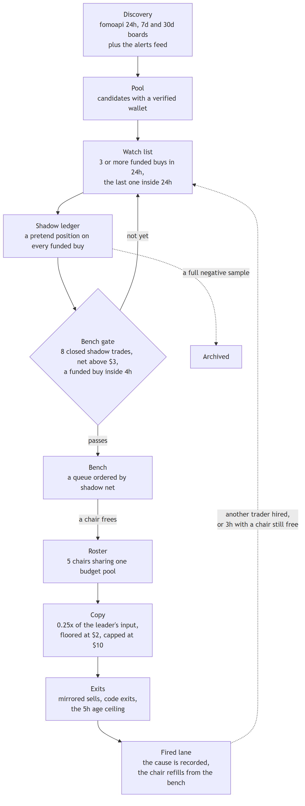
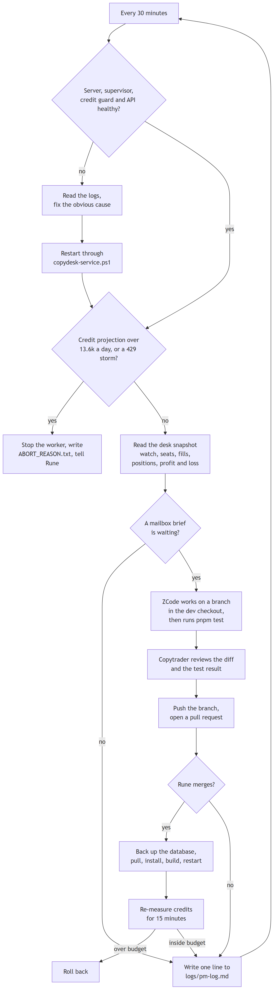

# Copydesk

**A copy desk that only trades what it has already proven.**

## What it is

Copydesk is a self-hosted Solana copy-trading desk for one operator. It runs on your own Windows PC, watches the wallets a leaderboard nominates, tests each one on a pretend ledger, and copies only the wallets that earn a place. A deterministic worker does the trading. Grok Bot, called Copytrader here, is the project manager around it: it watches the desk, keeps the bills inside their free tiers, briefs the builder, and tells you what happened.

What you end up with:

- a five-chair roster of proven leaders sharing one $100 budget pool
- copies at 0.25x the leader's measured input, with a $2 floor, a $10 ceiling per buy, and $40 open per leader
- mirrored leader sells, plus code exits: a 25% stop, a trailing stop, a half-position take-profit, and a five-hour age ceiling with a 90-minute grace window
- a mobile-first dashboard at http://127.0.0.1:8787 with the pipeline, the seats, the watch list, and an audit line for every decision
- paper fills by default; live signing only after a readiness check and a separate arming action
- a Helius credit plan that spends a planned 5,796 credits a day under a 13,600 hard cap
- Grok Bot as the on-call operator: a check every 30 minutes, a morning status, and build work routed to ZCode

## Getting started

**The double-click path.** Run `install.bat` from the project folder. It installs a portable Node if you do not have one, installs pnpm and the dependencies, builds every package, creates `.env` from `.env.example` with a generated `SESSION_SECRET`, creates the SQLite database, offers to load the example candidates, and adds Start Menu and Desktop shortcuts. It never overwrites an existing `.env`. The shortcuts are named ZCode Bot because that was the project's first name; they start Copydesk.

Run `launch.bat` or the shortcut. It starts the server if it is not already running. Browser auto-open is disabled on purpose, so the launcher cannot lock the Chrome profile used by the manual FOMO fallback. Open [http://127.0.0.1:8787](http://127.0.0.1:8787) yourself. The first login asks for the one-time setup token printed by the server and written to `data/setup-token.txt`; it is valid for 30 minutes, and `pnpm user:token` reprints it. You choose the username and password then.

**The terminal path.**

```bash
pnpm install
cp .env.example .env        # set SESSION_SECRET to 32+ random characters
pnpm build
pnpm db:migrate
pnpm start
```

`pnpm db:seed` optionally imports `fixtures/leaderboard.example.json`. `pnpm dev:server` runs the server from source instead of the built output.

When it works you land on the TRADE page with a PAPER badge, the pipeline, five roster chairs, the watch list, and the audit trail. `pnpm demo` starts a separate fictional 28-second replay and writes nothing to the live tables. The short operator guide is [docs/GETTING_STARTED.md](docs/GETTING_STARTED.md).

## How a wallet earns a chair

The desk is a pipeline with five dashboard stages, a bench queue between the watch list and the roster, and a return lane for fired chairs. Each stage is visible on the dashboard and carries a count.

| Stage         | What happens                                                                                                                                                                           | What gets through                                                                                                                                                                                         |
| ------------- | -------------------------------------------------------------------------------------------------------------------------------------------------------------------------------------- | --------------------------------------------------------------------------------------------------------------------------------------------------------------------------------------------------------- |
| Discovery     | The fomoapi 24h, 7d, and 30d boards plus the alerts feed are read on demand.                                                                                                           | Candidates with a stable identity; a verified Solana wallet when the inlet supplies one.                                                                                                                  |
| Pool          | Every candidate the inlet has seen waits here, with or without a wallet.                                                                                                               | Nobody is hired from this list.                                                                                                                                                                           |
| Watch list    | The watch tick observes twenty wallets; the monitor reads their funded buys and sells on a five-minute clock.                                                                          | A wallet enters with at least three funded buys in 24 hours and a last funded buy inside 24 hours.                                                                                                        |
| Shadow ledger | The ledger opens a pretend position on every funded buy at the notional the desk would have used, and closes it on the leader's sell, a code exit, or the age ceiling at a live price. | None of this spends money; it is the evidence.                                                                                                                                                            |
| Bench         | A watched wallet joins the bench when its shadow record passes the gate.                                                                                                               | At least eight closed shadow trades, net shadow PnL above $3, a funded buy inside four hours, and no re-entry ban. The bench is a queue ordered by shadow net, and it can fill while every chair is full. |
| Roster        | Five chairs share one budget pool. A freed chair takes the best bench record.                                                                                                          | A chair can stay empty; that is an accepted state.                                                                                                                                                        |
| Exits         | The worker mirrors a leader's sell at the same fraction. Code exits handle the rest.                                                                                                   | Closing a position updates realized PnL, the loss streak, and equity.                                                                                                                                     |
| Fired lane    | The desk records every firing with its cause and whether the chair was refilled.                                                                                                       | A fired wallet cannot return immediately: another trader must be hired first, or three hours must pass while a chair is still free. He then re-enters the same promotion gates with his shadow record.    |



_Follow one wallet down the page: it enters from discovery, earns evidence in the shadow ledger, waits on the bench, and takes a chair only when the gate and a free seat agree._

Discovery is demand-driven, not scheduled. It runs when a free chair has nothing promotable behind it, or when the bench sits below its target of ten wallets, and at most once every 30 minutes. A full roster with a full bench does not run discovery.

The fomoapi free tier is 250,000 credits a month. A leaderboard read costs 250 credits and an alerts read about 125; an unchanged board answered with an ETag costs nothing. Each run writes one audit line with the rows read, the traders added, and the credits spent and left.

## Grok Bot at the desk

Two kinds of work happen at this desk. The worker trades; Copytrader manages everything around the trade. The worker is a fixed rule engine on this PC. Copytrader, your Grok Bot assistant, reads the logs, keeps the budget, and talks to you from your phone. The trade path never waits for it.

| Role                        | Who                   | Does                                                                            |
| --------------------------- | --------------------- | ------------------------------------------------------------------------------- |
| Owner                       | You (Rune)            | Funds the wallet, approves live trading, merges pull requests, overrules a hire |
| Project manager and on-call | Copytrader (Grok Bot) | Health, credits, desk oversight, hire review, build briefs, the morning report  |
| Builder                     | ZCode on this PC      | Writes code on a feature branch in a separate dev checkout, runs the tests      |
| Worker                      | The Copydesk server   | Watches, sizes, quotes, signs, sends, exits, reconciles                         |

**What Copytrader does.**

- **Health.** Every 30 minutes it checks the server, the supervisor, the credit guard, and the API on `127.0.0.1:8787`. If something is down, it reads the logs, fixes the obvious cause, and restarts the desk through `scripts\copydesk-service.ps1`.
- **Credits.** It watches the Helius projection against a hard cap of 13,600 credits a day and stops the worker when the projection runs over or when 429s arrive in a storm. It keeps fomoapi usage modest as well.
- **Desk review.** It looks at the traders discovered, the seats filled, paper and live fills, open positions, profit and loss, exits that fired, and any seat that looks stuck.
- **Hires.** The worker fills a free chair from the top of the bench when `HIRE_APPROVAL=auto`, which is the shipped default. Copytrader reviews the pick, reports it, and you can overrule. With `HIRE_APPROVAL=agent`, the seat stays empty until a hire decision arrives at the agent API; that is the mode where Copytrader chooses the trader.
- **Exit tightening.** Copytrader may tighten an exit, for example by cutting a position early. It may never loosen one. The stop, the trailing stop, and the five-hour ceiling still apply.
- **Build management.** Bugs and ideas become briefs for ZCode. ZCode builds on a branch in the dev checkout and runs `pnpm test`. Copytrader reviews the diff, pushes the branch, and opens a pull request. You merge. Copytrader then deploys: back up the database, pull, install, build, restart, and re-measure credits for about 15 minutes, rolling back if the projection runs over budget.
- **Reporting.** It writes one entry per check to `logs/pm-log.md`. It sends a morning status between 06:15 and 06:45 Helsinki time, and messages you during the day only for a desk that is down, a budget guard trip, a pull request ready for review, or a hire you may want to overrule.

**What it never does.**

- Sign a transaction, place an order, or move funds.
- Switch the desk from paper to live. Only you do that.
- Merge a pull request.
- Let anyone edit the live folder directly. Code goes through the dev checkout and a pull request.
- Print, paste, or share a secret.
- Run the desk on two machines at once.
- Touch your unrelated projects, processes, or scheduled tasks.

**What it needs.** Copytrader reaches this PC through the Grok Bot desktop app, with "Execution on this computer" allowed in Settings, and the PC awake. If the app is closed or the PC is offline, Copytrader cannot reach the desk. The desk keeps running on its own.

The full account, including the mailbox protocol, the model ladder, and the exact service commands, is [docs/GROK-BOT.md](docs/GROK-BOT.md).

## Running the desk as a service

**The deployment path.** The deployment copy adds a `scripts\` folder that is not part of the tracked source tree. Three scripts in it watch the live desk. `copydesk-service.ps1` starts, stops, restarts, or reports the desk. It launches `copydesk-supervisor.ps1` in a hidden window; the supervisor starts the server and `credit-guard.py`, restarts the server with a backoff when it dies, and stops when it sees `logs\copydesk.stop`. The credit guard reads the Helius meter and stops the desk when a 15-minute rate projects over 13,600 credits a day (with at least 40 credits spent in that window), or when 20 or more 429s land in 15 minutes. It writes `logs\ABORT_REASON.txt` when it trips.

From PowerShell in the project folder:

```powershell
powershell -NoProfile -ExecutionPolicy Bypass -File .\scripts\copydesk-service.ps1 status
powershell -NoProfile -ExecutionPolicy Bypass -File .\scripts\copydesk-service.ps1 start
powershell -NoProfile -ExecutionPolicy Bypass -File .\scripts\copydesk-service.ps1 stop
powershell -NoProfile -ExecutionPolicy Bypass -File .\scripts\copydesk-service.ps1 restart
```

`start` and `stop` touch only the pids recorded in `logs\`; the scripts leave unrelated processes and ports alone. The supervisor imports the secrets file and points Node at `scripts\helius-meter.mjs`, so every Helius call is metered into `logs\helius-credits.jsonl`.

**Auto-start.** The Startup shortcut `Copydesk start.lnk` starts the desk at logon in a hidden window. For a start at boot plus restart on failure, run this once in PowerShell as administrator:

```powershell
powershell -ExecutionPolicy Bypass -File .\scripts\install-copydesk-task.ps1
```

The task is named "Copydesk". It does not modify the older "Copydesk watchdog" task, and it refuses to touch protected task names.

**Secrets.** They live in a restricted folder outside the repo that only your Windows user can read. The supervisor imports them into the server's environment at start. They never appear in chat, in logs, or in a commit. If you move the project folder, update the `$Root` at the top of `scripts\copydesk-service.ps1`, `scripts\copydesk-supervisor.ps1`, `scripts\credit-guard.py`, and `scripts\install-copydesk-task.ps1`, plus the embedded path in the task installer.

**A fresh clone without the deployment scripts.** `install-watchdog.bat` creates two hooks: a Startup-folder shortcut that starts the server at logon, and a scheduled task named "Copydesk watchdog" that runs `watchdog.bat` every five minutes. The script asks `http://127.0.0.1:8787/api/bootstrap`; when nothing answers, it starts `run-server.bat` again. The server's output goes to `data/server.log`; watchdog transitions go to `data/watchdog.log`. The watchdog deliberately leaves a server that listens but does not answer alone, because killing it blind could strand an in-flight trade. Remove the hooks with `schtasks /Delete /TN "Copydesk watchdog" /F` and by deleting `Copydesk.lnk` from the Startup folder.

**Linux.** `deploy/copydesk.service` is a systemd unit for a Linux host. It runs the built server with the repo as its working directory and restarts on failure.

## The dashboard

The server listens on `127.0.0.1:8787` by default. The four tabs are TRADE, OPS, SETTINGS, and AUDIT. TRADE is the dashboard: equity, the pipeline spine, the roster seats, open positions, and the watch rail. OPS carries the commands that normally need a terminal (build, migrations, tests, backup, restart, shutdown, wallet setup). SETTINGS carries provider keys, risk limits, pause and emergency stop, live readiness, and manual import. AUDIT carries every admission, shadow trade, promotion, rejection, fill, firing, and risk block with its reason.

`#/desk` is the assembly-line view: SOL balance, USDC available, unrealised P&L, a funnel of the server's stage counts, the five seats with their open copies, the credit meter, and a risk form. The badge reads LIVE only when the server reports armed and healthy; otherwise it reads PAPER, or DEMO with a banner.

For a phone on the same Wi-Fi, run `enable-phone-access.bat`. It asks for one UAC approval, adds a firewall rule for port 8787, sets `HOST=0.0.0.0` in `.env`, restarts the app, and prints the address. Traffic is plain HTTP; keep it on your own network or behind a VPN, and never forward the port to the internet.

## How a copy happens

**Monitoring.** With a Helius key, the roster uses a `logsSubscribe` WebSocket for up to five seats, with a hot spare and a five-minute signature-first safety poll. If both sockets stay down for 60 seconds, the desk switches to a 45-second signature-first poll on a separate outage budget. The watch list keeps its own five-minute poll. The trading monitor never uses the public RPC; that endpoint belongs to the candidate activity refresh.

**Classification.** A leader event is accepted only when it is a swap the classifier can read. Duplicate events are dropped by `(chain, leader, signature, leg)`. Buys older than 90 seconds are rejected. Two buys of the same mint by the same leader inside 60 seconds are coalesced into the existing position. An ambiguous swap is skipped.

**Sizing.** The copy notional is `clamp(0.25 x leader input, $2, $10)`, then capped by the leader's remaining $40 open room and the shared deployed cap (80% of capital, so $80 on a $100 bankroll). The $2 minimum is a floor. A buy that would scale below it is placed at $2; it is not skipped.

**Risk gates.** Before a quote is requested, the engine checks the deployed share of capital, the day's realized loss, the age of the price (45 seconds), maximum slippage (300 bps), and maximum price impact (300 bps). The engine writes a rejection to the audit trail with the rule name and the numbers that failed.

**Execution.** Jupiter Swap API v2 `GET /swap/v2/build` on `api.jup.ag` supplies the route. Paper mode simulates the fill at the quote, or at the cached price with 30 bps of adverse slippage and 5 bps of fees when there is no quote. Live mode becomes reachable only after the readiness checklist and a separate arming action; it signs and submits only while armed. Automated tests and the demo never construct the live executor.

**Exits.** A leader sell closes the same fraction of the copied position. The code exits run before the clock: a -25% stop, a trailing stop that arms at +15% and sells 10% off the peak, and a partial take-profit at +40% that sells half. At five hours a green position sells; otherwise it enters a 1.5-hour grace window, sells on an 8% bounce off the grace low while still below entry, or is force-closed at the deadline. Exit attempts use a 300, 600, then 1,000 bps slippage ladder.

**Firing.** The desk fires a chair for one of four reasons: two losing closes in a row, a leader wallet silent for eight hours while a position is open, eight hours with no open positions, or a manual FIRE. The fire is transactional: the chair is marked FIRING and unsigned orders are cancelled in one database transaction, then the position policy runs, then the bench is asked for a replacement. A close-out that needs reconciliation freezes only that chair.


_One copied trade from the worker's side: the push or poll, the gates, the quote, the fill, and the two ways the position ends._

## Inside the Grok Bot loop

Copytrader runs on a 30-minute calendar, not on the trading clock. The worker keeps trading whether or not Copytrader checks in.

| When (Helsinki time)      | What                                                                                             |
| ------------------------- | ------------------------------------------------------------------------------------------------ |
| Every 30 minutes, all day | Health, credit, desk, and build checks; one entry in `logs/pm-log.md`                            |
| 06:15 to 06:45            | One morning status covering the night                                                            |
| 23:00 to 06:15            | Quiet hours; only an unrecoverable outage or a credit-guard trip                                 |
| Daytime                   | Only what you would want at once: desk down, budget trip, pull request ready, a hire to overrule |
| On demand                 | Anything you ask in the Grok Bot chat                                                            |



_One tick, read from the top: health first, then the budget, then the desk, then any brief. The build path leaves the loop at a pull request and returns after your merge._

**The build route.** The default is the mailbox, because a mailbox run appears in the ZCode app where you can follow it. Copytrader drops a brief in the mailbox `inbox\`, ZCode picks it up, claims it, works on a branch in the dev checkout, runs `pnpm test`, commits, writes a reply in `outbox\`, and archives the brief. Copytrader reads the reply, reviews the diff, pushes the branch, and opens a pull request. You merge; Copytrader deploys and re-measures credits. One scheduled task in ZCode, under the CopyDesk project, drives this route. You create it; Copytrader never creates or edits automations. Runs only fire while the PC is awake and ZCode is running, and a missed slot is skipped, not caught up.

A brief carries `id`, `created`, `cwd`, `branch`, `base`, `mode` (`build`, `plan`, or `review`), `deadline`, and `from`, then the instructions. A reply carries `status` (`done`, `failed`, or `blocked`), `branch`, `commits`, `testsPassed`, `summary`, `questions`, and `finishedAt`. `peek.ps1` is the cheap gate: `EMPTY`, `NEW <id>`, or `RESUME <id>`. `mbox.ps1` claims and finishes a brief. `zc-post.ps1` posts one and can wait for the reply. The full procedure is `RUNBOOK.md`. The mailbox and the launcher live under `%USERPROFILE%\.zcode\grokbot-cli\`.

**The handshake.** Before a job, the launcher checks the model ladder. It verifies that the provider and model exist and that a key is present, without printing the key. It pins the chosen rung by writing a temporary provider config copy and pointing ZCode at it with `ZCODE_PERSONAL_PROVIDER_CONFIG_FILE`; your real ZCode config is not modified. After the session starts, it checks that ZCode resolved the pinned model. If not, it stops before the first model call and moves down the ladder.

A watchdog kills the process tree after 180 seconds without activity or at the 1,200-second total timeout. ZCode's own retries are capped at 2. The launcher stops at once on a quota, 429, insufficient balance, 401, 403, or auth error. The exit reasons are `ok` 0, `quota` 20, `auth` 21, `timeout` 30, `stalled` 31, `error` 1, and `all-exhausted` 40.

**The model ladder.** Four rungs, in order: GLM-5.3-Flash on the Z.ai Start plan, GLM-5.3-Flash on the Z.ai Individual coding plan, deepseek-flash on the DeepSeek API, and DeepSeek V4.1 Flash on OpenRouter. A run falls to the next rung only on a quota, auth, or configuration problem; a timeout or stall stops the run instead. When every rung fails, Copytrader asks you to add credits.

**What a run leaves behind.** `last-run.json` records the start and end, the exit reason, the provider and model used, the session id, the model ZCode actually resolved, the call count, the summary, the skipped rungs, the attempts, the usage, and the log path. `last-check.json` holds the result of `zc.ps1 -Check`. `runs\<timestamp>.log` holds the full output of every attempt. Headless CLI runs do not appear in the ZCode app; the mailbox route exists so that the work does.

**What it costs.** Every automation run pays for ZCode's roughly 50,000-token system prompt, even when the inbox is empty. On deepseek-flash, an empty 30-minute schedule costs about $0.03 to $0.05 a day while the prefix cache holds, and under $1 a day in the worst case. A real job costs extra.

## Risk limits

All values are defaults, editable in `.env` and most of them in the Settings risk form. Money limits are integer micro-USD internally.

| Limit                              | Default                                                                 | Environment name                                                                  |
| ---------------------------------- | ----------------------------------------------------------------------- | --------------------------------------------------------------------------------- |
| Starting bankroll                  | $100                                                                    | `EQUITY_START_USD`                                                                |
| Copy scale                         | 0.25x                                                                   | `COPY_SCALE`                                                                      |
| Per-buy floor / ceiling            | $2 / $10                                                                | `MIN_PER_BUY_USD` / `MAX_PER_BUY_USD`                                             |
| Open exposure per leader           | $40                                                                     | `MAX_OPEN_PER_TRADER_USD`                                                         |
| Deployed cap                       | 80% of capital                                                          | `MAX_DEPLOYED_PCT`                                                                |
| Daily realized loss stop           | $15                                                                     | `MAX_DAILY_REALIZED_LOSS_USD`                                                     |
| Max hold / grace                   | 5 hours / 1.5 hours                                                     | `MAX_POSITION_AGE_HOURS` / `POSITION_GRACE_HOURS`                                 |
| Stop loss                          | -25% from entry                                                         | `STOP_LOSS_BPS`                                                                   |
| Trailing stop                      | arms at +15%, sells 10% off the peak                                    | `TRAIL_ARM_BPS` / `TRAIL_DISTANCE_BPS`                                            |
| Partial take-profit                | +40%, sells half                                                        | `PARTIAL_TP_BPS`                                                                  |
| Sell on green                      | on                                                                      | `SELL_ON_GREEN`                                                                   |
| Exit slippage ladder               | 300 / 600 / 1,000 bps                                                   | `EXIT_SLIPPAGE_BPS_1` to `_3`                                                     |
| Max entry slippage / price impact  | 300 / 300 bps                                                           | `MAX_SLIPPAGE_BPS` / `MAX_PRICE_IMPACT_BPS`                                       |
| Max copied event age               | 90 seconds                                                              | `MAX_COPY_EVENT_AGE_SECONDS`                                                      |
| Max price age                      | 45 seconds                                                              | `PRICE_MAX_AGE_SECONDS`                                                           |
| Admission                          | 3 funded buys in 24h, last within 24h                                   | `ADMISSION_MIN_BUYS_24H` / `ADMISSION_MAX_LAST_BUY_HOURS`                         |
| Promotion                          | 8 closed shadow trades, net above $3, last buy within 4h                | `PROMOTION_MIN_CLOSED` / `PROMOTION_MIN_NET_USD` / `PROMOTION_MAX_LAST_BUY_HOURS` |
| Watch list / bench target / roster | 20 / 10 / 5                                                             | `WATCH_LIST_SIZE` / `BENCH_TARGET` / `ROSTER_SIZE`                                |
| Idle fire                          | 8 hours                                                                 | `IDLE_FIRE_HOURS`                                                                 |
| Stall fire                         | 8 hours                                                                 | `LEADER_STALL_FIRE_HOURS`                                                         |
| Pre-hire activity gate             | last copyable trade within 20h, at least 3 in 24h, from a fresh reading | `MAX_LEADER_STALL_HOURS` / `MIN_LEADER_SWAPS_24H`                                 |
| Re-entry after a firing            | after another trader is hired, or 3 hours if a chair is still free      | `COOLDOWN_HOURS`                                                                  |
| Agent hire decisions per day       | 3                                                                       | `MAX_HIRES_PER_DAY`                                                               |
| Watch eviction                     | after 14 days without a funded buy                                      | `WATCH_EVICTION_DAYS`                                                             |
| Per-mint cap                       | off (0 disables it)                                                     | `PER_MINT_CAP_USD`                                                                |

The risk form refuses an inverted pair (a maximum below the minimum), a per-leader open cap below the per-buy maximum, a decreasing exit slippage ladder, and a bench target above the watch-list size. Raising a limit from the dashboard needs `RISK_PIN`; an empty PIN rejects every increase.

## Helius credits

Helius is the metered provider in the trading loop. The free plan is 1,000,000 credits a month. The governor plans a 5,796-credit day and refuses spend past a 13,600-credit daily hard cap; the planned month stays under 600,000 credits.

| Bucket  | Daily cap | Expected day | Notes                                                                           |
| ------- | --------- | ------------ | ------------------------------------------------------------------------------- |
| roster  | 4,000     | 2,000        | Ring-fenced; WebSocket bytes and safety polls.                                  |
| exit    | 1,500     | 300          | Ring-fenced; never paused by the degrade ladder.                                |
| watch   | 2,500     | 800          | Helius fallback only; public RPC first.                                         |
| wallet  | 500       | 300          | Balance and fee reads.                                                          |
| vetting | 3,000     | 1,500        | One of only two paths allowed to use `getTransactionsForAddress`.               |
| agent   | 1,500     | 600          | Hire deep-dives; the other full-history path.                                   |
| token   | 500       | 200          | Mint and account reads.                                                         |
| health  | 100       | 96           | One `getSlot` every 15 minutes.                                                 |
| outage  | 6,000     | 0            | Reserve used only while both roster sockets are down; outside the 13,600 total. |

The timer loops are signature-first: `getSignaturesForAddress`, then `getTransaction` for a signature not seen before. `getTransactionsForAddress` is refused on every timer path. Candidate activity refreshes go to the free public RPC first and fall back to Helius only on failure. A 429 backs off, and an exit is retried with jitter rather than discarded: the exit and roster buckets are exempt from the pause.

The monthly ladder is green, amber at 450,000 credits, red at 550,000, roster-only at 600,000, and exits-only at 900,000; daily path ratios can also raise the level. The dashboard's credit meter reads `GET /api/credits`; when `HELIUS_PROJECT_ID` and a key are set, the worker reconciles the in-app meter against Helius's own usage every 30 minutes and trusts the higher figure.

## What it does not do

- **The roster starts empty.** A wallet has to earn a chair: eight closed shadow trades, more than $3 net, a fresh funded buy. The first hours, sometimes a full day, are observation. An empty chair is normal.
- **Paper fills are assumptions.** A quote simulation, or a cached price with 30 bps of slippage, is not an execution. Demo and paper results are never real returns.
- **Live mode is not exercised by the tests.** Every automated test and the demo use simulated fills. Signing needs the readiness checklist, the exact acknowledgment string, and a separate arming action.
- **Your PC is the runtime.** If the machine sleeps, loses the network, or shuts down, monitoring stops. The dashboard on your phone is a remote view, not a remote runtime.
- **Grok Bot is a remote operator, not a runtime.** If the Grok Bot app is closed or the PC is unreachable, the desk keeps running but Copytrader cannot check it.
- **The mailbox costs tokens while idle.** Every automation run pays for the system prompt, even when the inbox is empty.
- **Headless ZCode runs are invisible in the app.** The mailbox route exists so the work shows up; the CLI fallback leaves only `last-run.json` and its run log.
- **Equity excludes fees.** Trade PnL is proceeds minus cost basis in USDC; network fees and account rent are paid in SOL from a separate reserve and measured by the fee ledger.
- **Reconciliation needs you.** An execution with an unknown outcome stays open until you resolve it with on-chain evidence, and those positions are kept out of equity.
- **Emergency stop is not a recall.** It blocks new entries and new signing at once. It cannot undo a transaction already on chain.
- **The dashboard is plain HTTP.** Keep it on the machine or your own Wi-Fi. Do not expose port 8787 without HTTPS and a reverse proxy.
- **The funded-buy screen can thin the pool.** When no watched wallet clears the admission bar, the watch list stays empty and discovery tries again later.
- **The WebSocket share of the Helius plan is an estimate.** The meter counts bytes, but the plan has not been calibrated against a full day of live traffic.
- **The shadow ledger always assumes 1% slippage per side.** The PnL the promotion bar reads is not a measured fill.
- **The live send path uses the SWQOS minimum tip.** The larger Sender Max tip is not the default.

## Technical appendix

Node 22 or newer, TypeScript throughout. The server is Hono with REST and SSE; the dashboard is React, Vite, and Tailwind; storage is SQLite through Drizzle with WAL; the chain side is `@solana/web3.js`, Helius for leader activity, and Jupiter Swap API v2 for quotes and swaps. Discovery talks to fomoapi from the server process. No language model decides anything in the trade path: admission, promotion, sizing, exits, and firing are deterministic code. Grok Bot and ZCode work around the worker, not inside it. Tests are Vitest, plus Playwright for the browser suite.

```
copydesk/
  apps/
    server/       Hono API, worker, monitor, executors, ops console, CLIs
    web/          React dashboard (TRADE, OPS, SETTINGS, AUDIT)
  packages/
    core/         money, sizing, exits, streaks, watch rules, credit governor
    db/           Drizzle schema, migrations, repositories
    providers/    fomoapi, Helius, Jupiter, public RPC, pricing, notifications
    config/       Zod env and risk validation
  docs/           runbook, getting started, Grok Bot integration, diagrams
  fixtures/       example imports and the fictional demo timeline
  scripts/        deployment copy: service, supervisor, credit guard, Helius meter
  tools/gui/      clipboard-driven PowerShell readers for desktop Chrome
  deploy/         systemd unit
  IMPLEMENTATION_PLANS/  sequenced build plans
  DECISIONS.md    binding operator decisions
  AGENTS.md       repository contract
  install.bat, launch.bat, install-watchdog.bat, watchdog.bat,
  run-server.bat, run-hidden.vbs, enable-phone-access.bat
```

A few rules matter more than the rest. The worker is the only authority: discovery nominates wallets, the bench gate decides who is ready, and nothing outside the engine sizes, signs, or exits. Everything fails closed: ambiguous swaps are skipped, unknown outcomes become reconciliation cases, a stale answer never invents a fill, and an empty chair is acceptable. Money is integer micro-USD in bigints, with token amounts as base-unit strings, never floats.

The project keeps its original name in a few places that predate the rename: the package scope is `@zcode-bot/*`, the database file is `data/zcode-bot.db`, the session cookie is `zcode_session`, and some installer shortcuts say ZCode Bot. Renaming them is a breaking change that touches a live database and your browser session.

The binding decisions live in [DECISIONS.md](DECISIONS.md) with the evidence behind each one, the repository contract in [AGENTS.md](AGENTS.md), the build and verification plan in [IMPLEMENTATION_PLANS/](IMPLEMENTATION_PLANS/), the operator runbook in [docs/RUNBOOK.md](docs/RUNBOOK.md), and the Grok Bot integration in [docs/GROK-BOT.md](docs/GROK-BOT.md).

## Where things live

- `data/zcode-bot.db`, the SQLite database in WAL mode
- `data/wallet/`, the encrypted Solana key
- `data/browser-profile-dawn/`, the Telegram session used for the optional wallet lookups
- `data/server.log`, `data/watchdog.log`, and `data/worker.lock`
- `data/setup-token.txt`, the one-time token on a fresh install
- `logs/pm-log.md`, Copytrader's running log; `logs/server.log`, `logs/watchdog.log`, and `logs/credit-guard.log` from the deployment supervisor
- `logs/helius-credits.jsonl` and `logs/fomo-credits.jsonl`, the metered spend
- `.env`, your configuration and keys, entered locally and never committed
- [docs/GETTING_STARTED.md](docs/GETTING_STARTED.md), the short operator guide; [docs/RUNBOOK.md](docs/RUNBOOK.md), the runbook; [docs/GROK-BOT.md](docs/GROK-BOT.md), the Grok Bot integration; [docs/FOMO_DAWN_FETCHING.md](docs/FOMO_DAWN_FETCHING.md), the manual fallback procedure
- `docs/diagrams/` and `docs/images/`, the editable diagram sources and their renders

Run the checks with `pnpm typecheck`, `pnpm test`, and `pnpm e2e`. `pnpm format` and `pnpm format:check` cover formatting. `pnpm demo` replays a fictional 28-second session without touching real data.
